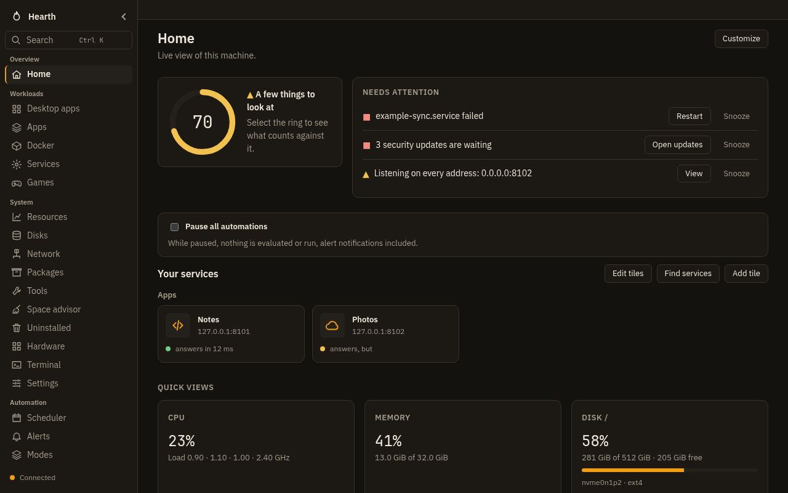

# Hearth

A lightweight, local-first system manager and monitor for a single Debian desktop or laptop. One place for what Homepage, Portainer, btop, Cockpit, a cron UI and the GUI package manager each do in part.



Written and maintained by **Mohammed Mosabeh** ([@mohammed-w-mosabeh](https://github.com/mohammed-w-mosabeh)). Licensed under [Apache-2.0](LICENSE).

## Features
- **Monitor**: CPU, memory, disks, temperatures, fans, GPU, battery and network, live and with history, forecasts and event markers on every chart.
- **Services and apps**: systemd units, desktop applications, processes and resource caps; crashes, sleep and boot analysis; a journal viewer.
- **Docker**: containers, images, networks, volumes, Compose projects and cleanup with previews.
- **Apps**: stacks deployed from a validated spec, with secrets, danger flags, backups, restore and an optional `<app>.localhost` proxy.
- **Packages**: apt through PackageKit, Flatpak and Snap, with "restart needed"; **Uninstall completely** with orphaned dependencies, leftovers and a 7-day restore.
- **Network**: listening ports and who owns them, connections, the firewall (ufw) and connectivity checks.
- **Security**: a posture page, Lynis, integrity watch, access review and an audit log of every change.
- **Automation**: scheduled jobs, alerts, Modes (one switch for a set of changes, reversible) and Automations (when, if, then) with a dry run over the last 7 days.
- **Also**: a Home page with a health ring and tiles for your services, a terminal, Ctrl+K for everything, a local CLI, reports, and settings backup.

More screenshots are in [`docs/design/screens/`](docs/design/screens/); every one is taken with invented data.

## Security model
Hearth can change a machine, so it is built around a few fixed rules:
- **Localhost only.** `hearthd` serves the UI on `127.0.0.1`. There is no LAN listener and no remote access.
- **Not root.** `hearthd` runs as you, as a systemd user service, and refuses to run as root.
- **A broker for root work.** What needs root goes through polkit, or through `hearth-broker`, a small socket-activated service with a closed list of methods. Nothing is ever run through a shell.
- **Every change is checked.** A state-changing request needs the session token and passes `Origin` and `Host` checks, so another site in your browser cannot drive it.
- **Preview, confirm, audit.** Destructive actions show what they will do first, ask, and are written to an audit log.
- **No telemetry.** Hearth has no account and sends nothing anywhere. It reaches the network only for what you ask of it (a connectivity check you set up, a package or image update).

The full list is in [`docs/SECURITY-INVARIANTS.md`](docs/SECURITY-INVARIANTS.md). To report a vulnerability, see [`SECURITY.md`](SECURITY.md).

## Install

Hearth targets **Debian 13 (trixie), amd64**, with systemd and polkit.

### From a release
Download `hearth_<version>_amd64.deb` and `SHA256SUMS` from the [releases page](https://github.com/mohammed-w-mosabeh/Hearth/releases) into one folder, then:

```sh
sha256sum -c SHA256SUMS
sudo apt install ./hearth_*_amd64.deb
```

**The packages are not signed yet.** `SHA256SUMS` only shows that the download matches what was published. If that is not enough for you, build from source.

### From source
You need Go 1.27.4, Node.js 22 with npm, `make`, `git` and `desktop-file-utils`.

```sh
git clone https://github.com/mohammed-w-mosabeh/Hearth.git
cd Hearth
make tools     # pinned build tools into .tools/bin, nothing system-wide
make deb       # dist/hearth_<version>_amd64.deb
sudo apt install ./dist/hearth_*_amd64.deb
```

### After installing
Open **Hearth** from the application menu, or run `hearthd open`. The service starts with your session (`systemctl --user status hearthd`). The local CLI is `hearth`: `hearth status`, `hearth ports`, `hearth alerts`.

To use the Docker pages and anything else that goes through the broker, your user must be in the `hearth` group; the installer and the UI say so:

```sh
sudo usermod -aG hearth "$USER"   # then log out and back in
```

To remove Hearth and what it wrote for the system: `sudo apt purge hearth`. Two things are kept on purpose, and the purge says so: app backups and uninstall archives under `/var/lib/hearth`, when there are any, and your own settings and history in `~/.local/share/hearth` and `~/.config/hearth`.

## Known limitations
- One machine, one user session, Debian 13 on amd64. Other distributions and architectures are not tested.
- English and Arabic only.
- Packages are unsigned, and there is no apt repository yet.
- No remote or LAN access, by design.
- Docker is managed through the broker; rootless Docker and Podman are not supported.
- The terminal and several pages need a desktop session (D-Bus user bus, polkit agent).

## Develop
Go, and Svelte 5 + Vite + TypeScript for the UI, which is embedded in the binary.

| Command | What it does |
|---|---|
| `make tools` | install the pinned build and lint tools into `.tools/bin` |
| `make dev` | hearthd with the Vite dev server, still on 127.0.0.1 |
| `make build` | the web bundle and the binaries |
| `make check` | lint, tests and vulnerability scan |
| `make itest` | integration and browser tests in a Debian 13 container with systemd and Docker |
| `make bench` | the resource budget |
| `make deb` | the `.deb` |

Start with [`CONTRIBUTING.md`](CONTRIBUTING.md). The design is in [`docs/SPEC.md`](docs/SPEC.md), [`docs/ARCHITECTURE.md`](docs/ARCHITECTURE.md), [`docs/SECURITY-INVARIANTS.md`](docs/SECURITY-INVARIANTS.md) and [`docs/ROADMAP.md`](docs/ROADMAP.md); the interface in [`docs/design/ember.md`](docs/design/ember.md).

## License
Apache-2.0, Copyright (c) 2026 Mohammed Mosabeh. See [`LICENSE`](LICENSE), [`NOTICE`](NOTICE) and [`THIRD_PARTY_NOTICES.md`](THIRD_PARTY_NOTICES.md).
